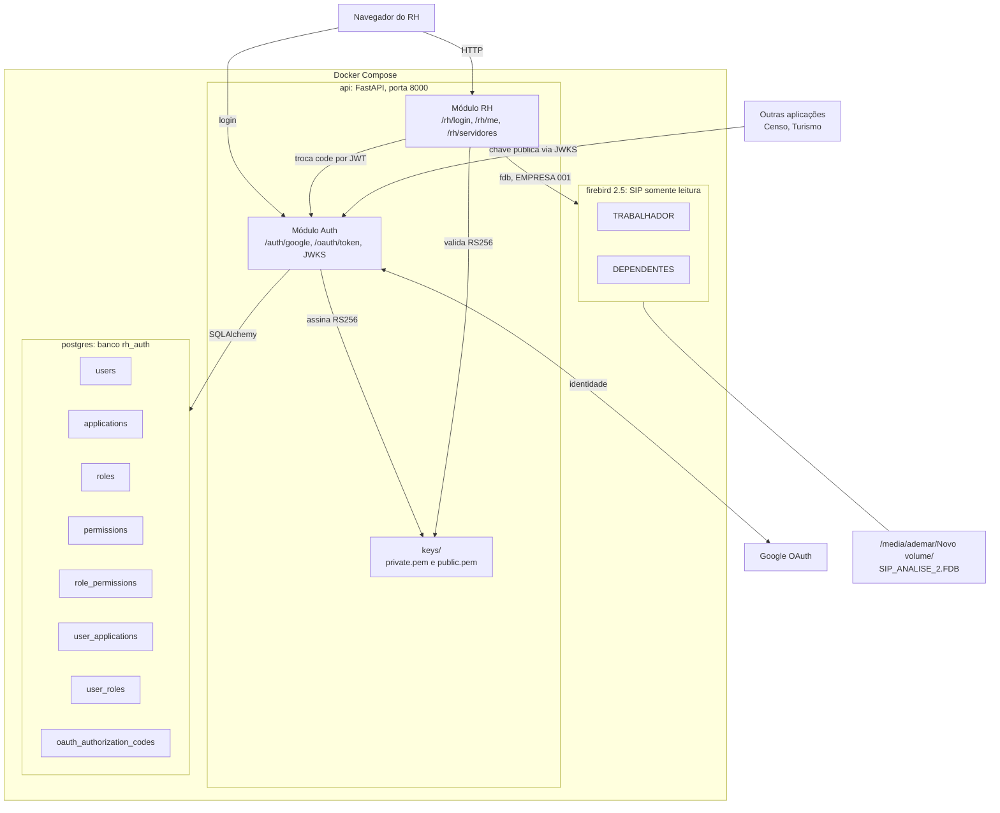
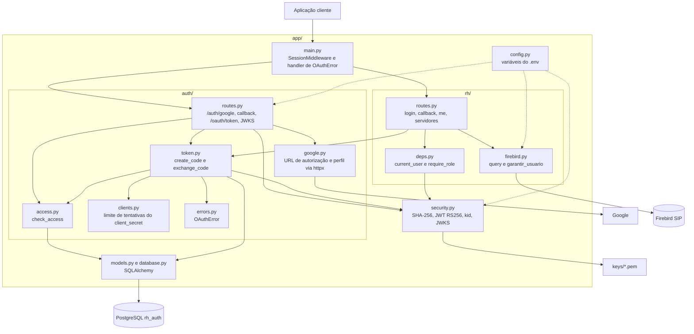
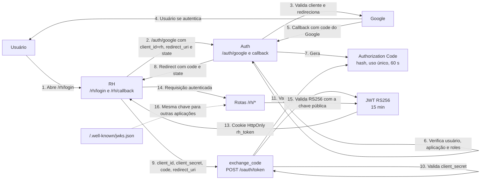
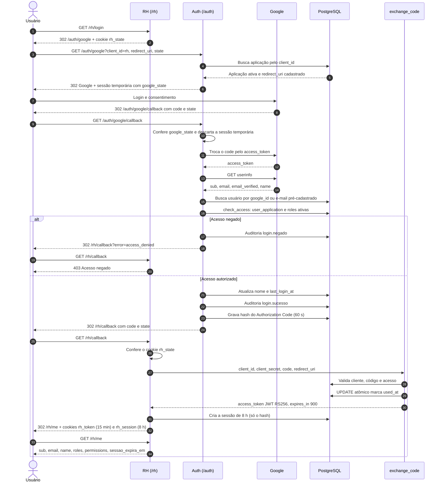
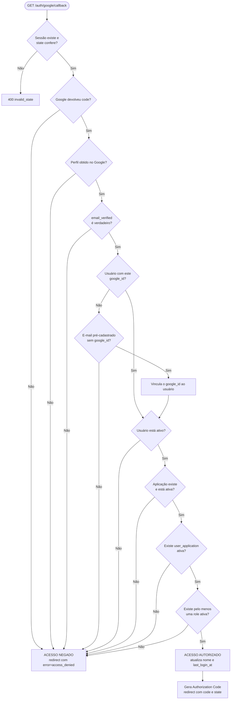
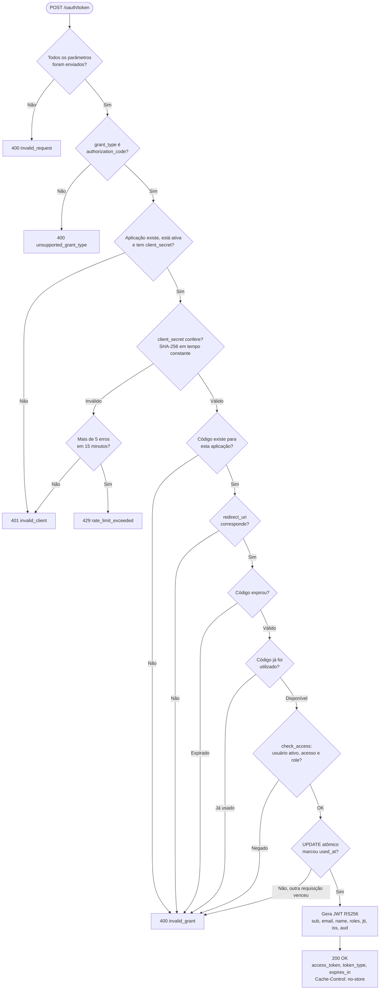
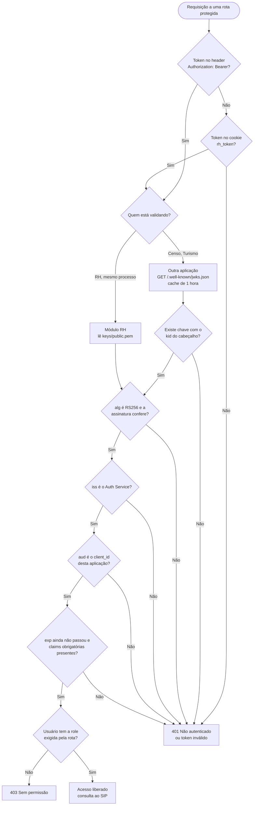
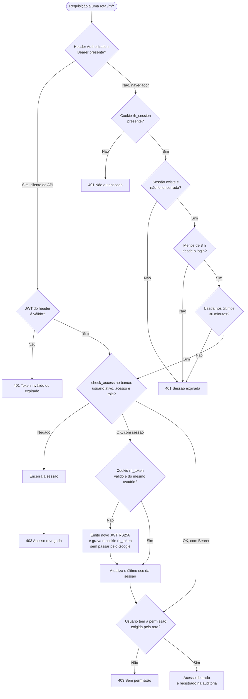

# MICRO_SERVICE_BACKEND_RH: diagramas

Diagramas do backend FastAPI (Auth Service + RH) como está implementado hoje, incluindo perfis, auditoria e sessão.
Sugestão: salvar este arquivo em `docs/DIAGRAMAS.md`; o GitHub renderiza os blocos Mermaid.

## 1. Visão geral da arquitetura

## 2. Componentes do Auth Service

## 3. Fluxo completo: Google OAuth, Authorization Code e JWT

## 4. Sequência detalhada do login

## 5. Fluxograma de autorização (callback do Google)

## 6. Fluxograma do `/oauth/token`

## 7. Validação do JWT e uso do JWKS

## 8. Sessão de 8 horas e renovação do token

A sessão também termina no logout, quando o administrador a encerra em `/rh/admin/sessoes`
ou quando o usuário é desativado.
